  

  <a href="https://spectrionstudio.github.io/portfolio/"><b>Portfolio</b></a> ·
  <a href="https://www.linkedin.com/in/kylianluangraj/">LinkedIn</a> ·
  <a href="mailto:kylian.luangraj@outlook.fr">E-mail</a>

---

### 🔴 En deux mots

Je suis étudiant en BTS SIO option SLAM au CNED, après une année de BUT MMI à Béziers. Je code parce que c'est l'endroit où je peux rendre réel ce que j'imagine, sans limite. Mon objectif : devenir développeur, puis chef de projet informatique.

> **🔎 En recherche d'un stage en développement d'applications** : 4 à 5 semaines, entre mai et août 2027.

---

### 🔴 Mon parcours

- **2026 →** BTS SIO option SLAM, CNED (à distance)
- **2025 – 2026** BUT MMI, Béziers
- **2024 – 2025** Baccalauréat général, Pézenas

---

### 🔴 Ce que j'ai construit

- 🤖 **[discord-bot](https://github.com/SpectrionStudio/discord-bot)** : un bot de modération pour mon serveur (bannissements, mutes, avertissements, anti-raid), avec une IA d'assistance branchée grâce à Ollama. `Python` `discord.py`
- 🌐 **[portfolio](https://github.com/SpectrionStudio/portfolio)** : mon portfolio, écrit en HTML, CSS et JavaScript et publié sur GitHub Pages. [Le voir en ligne](https://spectrionstudio.github.io/portfolio/)
- 🏛️ **[les-halles-de-beziers](https://github.com/SpectrionStudio/les-halles-de-beziers)** : une SAE du BUT MMI, le site des Halles de Béziers avec une visite à 360°, habillé comme la tablette Sheikah de *Zelda : Breath of the Wild*. Inachevé, mais ce qu'il m'a appris sur la gestion du temps n'est pas près de s'oublier.
- ⚔️ **[rpg-prototype-python](https://github.com/SpectrionStudio/rpg-prototype-python)** : un prototype de RPG en 2D. `Python`
- 🎮 **[mini-jeu-deplacement](https://github.com/SpectrionStudio/mini-jeu-deplacement)** : mon tout premier petit jeu, fait en NSI au lycée. `JavaScript`

---

### 🔴 Mes outils

| | |
|---|---|
| **Langages** | Java · HTML / CSS · JavaScript · Python · SQL |
| **Outils** | Git · GitHub · MySQL · Unity · Visual Studio Code |
| **Systèmes** | Windows · Linux (notions) |
| **Méthodes** | Gestion de projet agile · UX/UI · accessibilité · responsive design |

---

### 🔴 En dehors du code

✍️ J'écris un roman (Light Novel) depuis plusieurs années, c'est de là que vient mon imagination · 📺 Je crée du contenu (YouTube, Twitch) et je monte mes vidéos · 🎮 Je joue beaucoup, en regardant comment les jeux sont construits · 🏅 Football, handball, baseball, natation, musculation · 🎤 Chant et karaoké

---

<i>Partager mes valeurs et rester bienveillant, c'est ma devise.</i>

