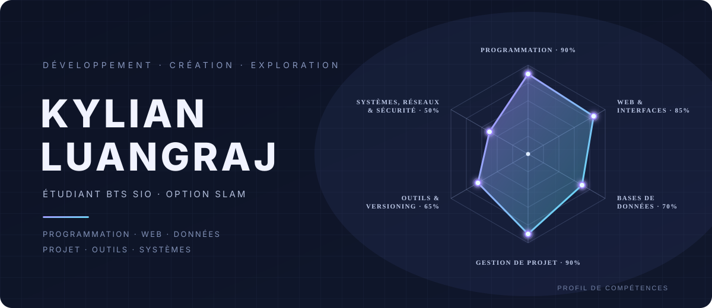

  

# Kylian Luangraj — Radar de compétences

Bannière statique réalisée en HTML, CSS et SVG. Aucun JavaScript, framework ou dépendance.

## Aperçu local (à faire plus tard)
Ouvre `index.html` dans un navigateur qui est la bannière ci-dessus mais interactive.

## À propos des points
Ces points représentent les grandes et principales catégories que l'on étudie dans notre BTS SIO SLAM. 

## Axes représentés
1. Programmation
2. Web et interfaces
3. Bases de données
4. Gestion de projet
5. Outils et versioning
6. Systèmes, réseaux et sécurité

 

> Un bot qui a sa personnalité ? Un site qui a son univers ? Un jeu qui a ses propres règles ? C’est le genre de projets qui me donne envie de coder.

Moi, c’est **Kylian**. Je suis étudiant en **BTS SIO — SLAM au CNED**. Je m’intéresse au développement d’applications, à l’interactivité et au game design.

  **STAGE EN DÉVELOPPEMENT** · 4 à 5 semaines · Mai — Août 2027

---

## Sur l’établi

<table>
  <tr>
    <td width="50%" valign="top">
      <h3>01 / SPECTRION BOT</h3>
      
Un bot Discord développé pour une communauté : modération, commandes utiles et assistant local.

      
<code>/ask</code> pour discuter · <code>/lore</code> pour explorer un univers narratif, avec Ollama en local.

      Python · discord.py · Ollama
        
      <a href="https://github.com/SpectrionStudio/discord-bot">VOIR LE DÉPÔT ↗</a>
    </td>
    <td width="50%" valign="top">
      <h3>02 / LES HALLES DE BÉZIERS</h3>
      
Une vitrine web imaginée comme une tablette Sheikah, avec une visite des lieux à 360°.

      
Un projet où l'identité visuelle et l'interaction comptent autant que les pages elles-mêmes.

      HTML · CSS · JavaScript
        
      <a href="https://spectrionstudio.github.io/les-halles-de-beziers/">VOIR LE SITE ↗</a>
      &nbsp;·&nbsp;
      <a href="https://github.com/SpectrionStudio/les-halles-de-beziers">CODE ↗</a>
    </td>
  </tr>
  <tr>
    <td width="50%" valign="top">
      <h3>03 / RPG PROTOTYPE</h3>
      
Un prototype collaboratif de RPG en Python : personnages, statistiques, premiers objets et une mécanique maison autour du « Spectrion ».

      
<em>Une base expérimentale, pas encore un jeu jouable.</em>

      Python · Aseprite · Krita
        
      <a href="https://github.com/SpectrionStudio/rpg-prototype-python">VOIR LE DÉPÔT ↗</a>
    </td>
    <td width="50%" valign="top">
      <h3>04 / MON PORTFOLIO</h3>
      
Un aperçu de mon parcours, de mes compétences et des réalisations que je construis au fil de ma formation.

      
<em>Le point d'entrée pour découvrir mon travail.</em>

      HTML · CSS · JavaScript
        
      <a href="https://spectrionstudio.github.io/portfolio/">VISITER LE PORTFOLIO ↗</a>
    </td>
  </tr>
</table>

---

## Mon terrain de jeu

`Python` &nbsp; `JavaScript` &nbsp; `HTML / CSS` &nbsp; `SQL` &nbsp; `Java`

`Git / GitHub` &nbsp; `MySQL` &nbsp; `Unity` &nbsp; `VS Code`

J'apprends, je teste, je casse parfois — puis je comprends pourquoi. C'est aussi pour ça que je garde ici des projets à différents stades, des premières expérimentations aux réalisations plus abouties.

## En dehors du code

J’écris un light novel et développe un univers narratif depuis plusieurs années. Ça nourrit naturellement mon intérêt pour le game design, les systèmes de jeu et les expériences qui racontent quelque chose.

---

  **Une idée à construire ou un projet à discuter ?**
   
  <a href="mailto:kylian.luangraj@outlook.fr">ÉCRIS-MOI ↗</a>
    
  Conçu et codé par Kylian Luangraj · Spectrion Studio

